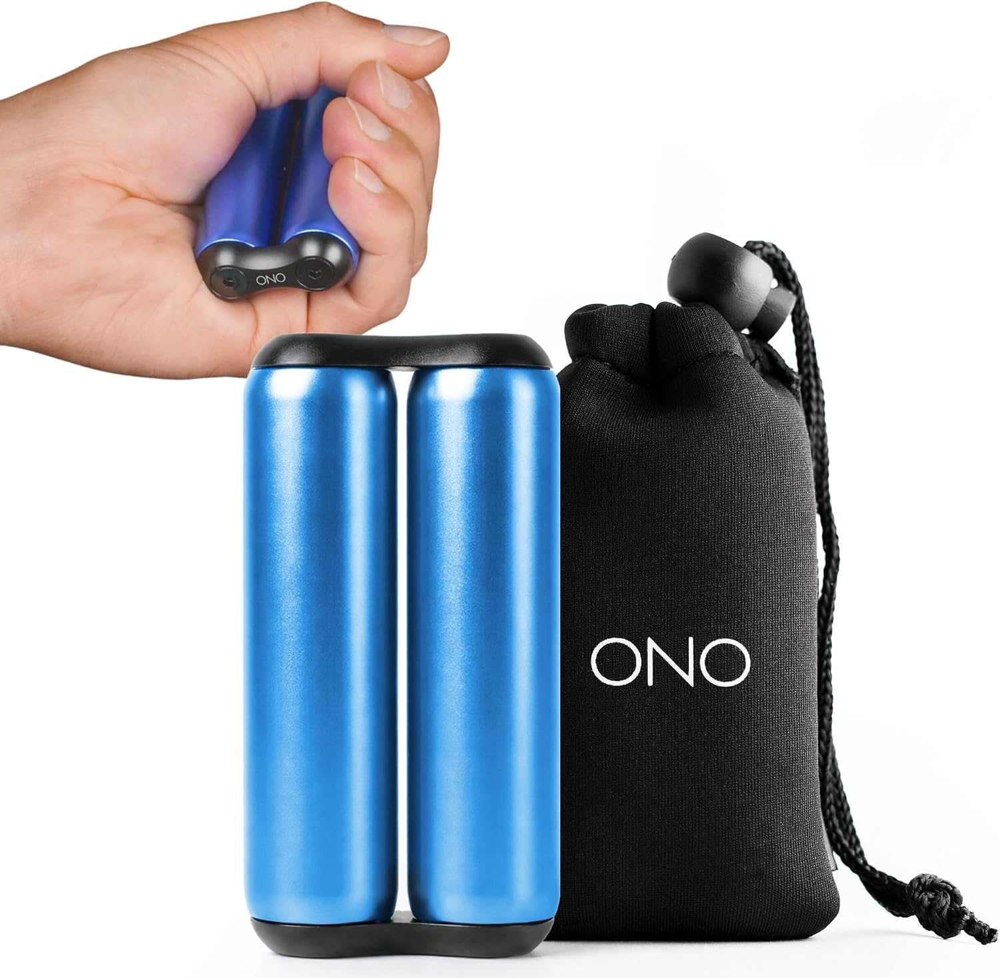

# XmasList2026

<!-- 
iPod 5.5 generation (Black preferred)
The iPod 5.5 generation is often considered the best for modding with Rockbox due to its superior sound quality, compatibility with flash storage upgrades up to 1TB, and ease of disassembly compared to later models.

iFlash-Solo https://www.iflash.xyz/store/iflash-solo/

 
-->

1) Remove leaves from the gutters

2) Portable Power Station. **At least 500wh (watt hours)**. I'd recommend go halves on this with someone else.

This is so when the power goes out, I can plug in the xfinity cable modem and wifi router into it and keep working. 500wh should run the cable modem and wifi router all day. If there is battery left over I can use it overnight.

You can find deals at Costco. Recommended brands I've seen are Jackery and Ecoflow. 

See the video at the timestamp for ranking charts. Both videos are a good watch.

A) https://www.youtube.com/watch?v=FfH4S1ttXiM&t=1166

B) https://www.youtube.com/watch?v=qtFOSmIXvwg&t=1077

3) Ono roller (metal preferred but can get plastic). Blue or green
https://www.amazon.com/dp/B079T416DB

Fancy extra virgin olive oil
* something in a green or brown glass bottle
* single origin
* Italian or California in origin.

---------------------

---------------------
