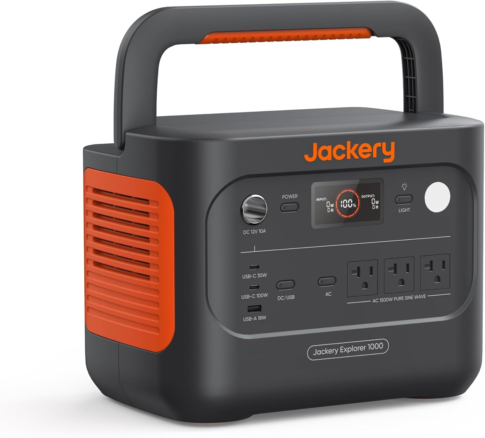
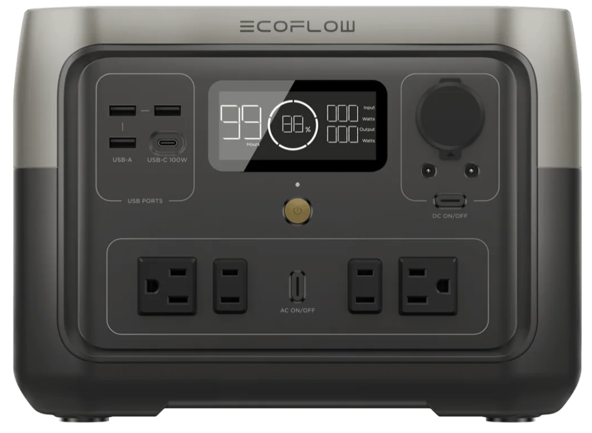
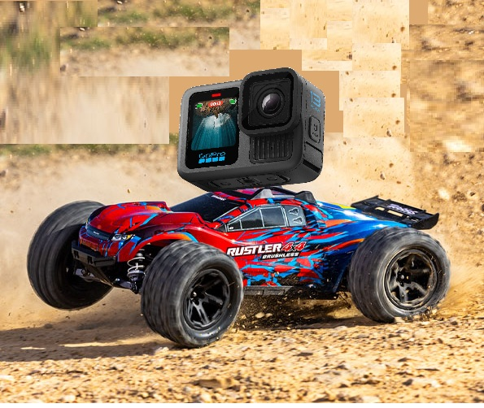

# XmasList2026

<!-- 
iPod 5.5 generation (Black preferred)
The iPod 5.5 generation is often considered the best for modding with Rockbox due to its superior sound quality, compatibility with flash storage upgrades up to 1TB, and ease of disassembly compared to later models.

iFlash-Solo https://www.iflash.xyz/store/iflash-solo/

 
-->

1) Remove leaves from the gutters

2) Portable Power Station. **At least 500wh (watt hours)**. I'd recommend go halves on this with someone else.

This is so when the power goes out, I can plug in the xfinity cable modem and wifi router into it and keep working. 500wh should run the cable modem and wifi router all day. If there is battery left over I can use it overnight.

You can find deals at Costco. Recommended brands I've seen are Jackery and Ecoflow. 

See the video at the timestamp for ranking charts. Both videos are a good watch.

A) https://www.youtube.com/watch?v=FfH4S1ttXiM&t=1166

B) https://www.youtube.com/watch?v=qtFOSmIXvwg&t=1077

3) Crawlspace exploration

* I have a go pro and your RC car. I want to strap the camera to the RC car and drive it underneath the house. I want to check for holes and how well the insulation was installed. I want to show Mom underneath the house. No one has to go under the house but I do need someone with me to open up the crawlspace and put the RC car under the house. I will drive it around and film. 

---------------------

---------------------
